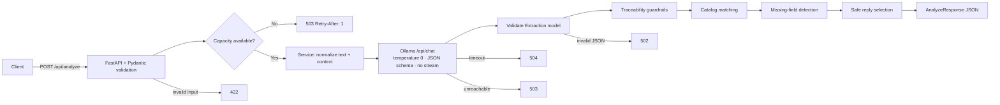

<div align="center">
  
  <h1>💊 Pharmacy Patient Assistant API</h1>
  <h3>Safety-First LLM Microservice | Multilingual NLP | Structured Extraction</h3>

  <p>
    An experimental Data &amp; AI service that turns free-text pharmacy requests
    (French, Darija, Arabic, mixed) into <strong>validated, structured JSON</strong>
    using a local LLM — built with <strong>FastAPI, Pydantic, Ollama and Llama 3.2</strong>.
  </p>

  
  
  
  
  
  
  
  
</div>

<br>

> ⚠️ **Disclaimer** — This is an **experimental research prototype**, not a medical device.
> It has no access to real stock, prices, pharmacy directories or patient records. It does not
> diagnose, prescribe, recommend a dosage, or confirm availability. Do **not** use it for real
> medical or commercial decisions. Measured extraction quality is currently insufficient
> (see [Evaluation](#evaluation)).

<hr>

## 📝 Table of Contents

1. [Project Overview](#overview)
2. [Architecture & Request Lifecycle](#architecture)
3. [API Reference](#api)
4. [Data Contracts & Intents](#contracts)
5. [Safety & Guardrails](#safety)
6. [Evaluation & Measured Results](#evaluation)
7. [Testing](#tests)
8. [Project Structure](#structure)
9. [Installation & Usage](#install)
10. [Configuration](#config)
11. [Limitations & Out of Scope](#limits)
12. [Roadmap](#roadmap)
13. [Legacy RAG Healthcare Assistant](#legacy)
14. [Contact](#contact)

<hr>

<a name="overview"></a>
## 🔭 Project Overview

This project is **Challenge 1** of a healthcare assistant program. The goal is to build a
small, isolated service that interprets patient messages addressed to a pharmacy and returns a
**strictly validated structured interpretation** that a downstream application could act on.

The service deliberately does **one job**: natural-language understanding. It is a stateless
microservice, separated from the historical Streamlit/Chainlit components of the repository.

### What it does

* **Multilingual understanding** — French, Arabic, Latin-script Darija, and mixed messages.
* **Structured extraction** — intents, medication names, quantity/unit, dosage, form, and pharmacy name/location.
* **Catalog matching** — maps extracted medicine names to a small demo catalog (exact alias match).
* **Clarification loop** — asks a deterministic follow-up when a required field is missing.
* **Context support** — accepts a previous simplified interpretation for follow-up corrections.
* **Defensive generation** — the LLM's free-text answer is never trusted blindly; only a small allow-list of safe replies is returned.

### What it explicitly does **not** do

* ❌ No stock, price, availability or opening-hours lookup
* ❌ No phone number or address verification
* ❌ No diagnosis, prescription, dosage or medical advice
* ❌ No voice interface (future extension, not implemented)
* ❌ No guarantee that an extraction is linguistically or clinically correct

<a name="architecture"></a>
## 🏗️ Architecture & Request Lifecycle

The service is intentionally simple: **one bounded LLM call per request**, wrapped in validation,
capacity control and deterministic post-processing.



### Request lifecycle

1. **Validation (422)** — Pydantic enforces types, required fields, `extra="forbid"`, non-blank text and size limits.
2. **Admission control (503)** — an in-process `asyncio.Queue` caps concurrent generations (`MAX_CONCURRENCY`).
3. **Prompt construction** — the user text and optional context are serialized as **data**, wrapped by a system prompt that forbids following embedded instructions.
4. **Single LLM call** — `POST /api/chat` with `stream=false`, `temperature=0` and a JSON schema (`format`).
5. **Schema validation (502)** — the raw model output must satisfy the internal `Extraction` model.
6. **Traceability guardrails** — every extracted entity must appear textually in the user message or the supplied context; otherwise it is removed and a warning is emitted.
7. **Catalog matching** — exact alias lookup against `catalog.json` → `found`, `ambiguous` or `unknown`.
8. **Clarification logic** — missing required fields produce a deterministic question and `needs_clarification=true`.
9. **Safe reply selection** — the model's reply is used only if it is in a fixed safe set; otherwise a deterministic fallback is chosen.
10. **Observability** — a structured log line records `request_id`, duration, model and outcome category — **never the user text**.

<a name="api"></a>
## 🚀 API Reference

Base URL: `http://127.0.0.1:8000` · Interactive docs: `/docs`

| Method | Endpoint | Description |
| :---: | :--- | :--- |
| `GET` | `/health` | Liveness check. Does **not** call Ollama. |
| `POST` | `/api/analyze` | Interpret a pharmacy request and return structured JSON. |

### `POST /api/analyze`

**Request**

```json
{
  "text": "Avez-vous du Doliprane 500 mg ?",
  "context": {
    "intents": ["availability"],
    "medications": [],
    "pharmacy": {}
  }
}
```

`context` is optional. When provided it must follow the `Context` schema; it is treated as data,
never as instructions. The service analyzes the **latest message** and uses the context for follow-ups.

**Illustrative response**

```json
{
  "request_id": "6f0f0b7e-6b6f-4a9b-9b2f-3f6f0e6a1c2d",
  "original_text": "Avez-vous du Doliprane 500 mg ?",
  "language": "french",
  "intents": ["availability"],
  "medications": [
    {
      "expressed_name": "Doliprane",
      "quantity": null,
      "unit": null,
      "dosage": "500 mg",
      "form": null,
      "normalized_name": "Doliprane",
      "catalog_id": "demo-doliprane",
      "match_status": "found"
    }
  ],
  "pharmacy": { "name": null, "location": null },
  "needs_clarification": false,
  "missing_fields": [],
  "clarification_question": null,
  "reply": "Demande comprise.",
  "warnings": ["unit_without_quantity_removed"]
}
```

**Error contract**

| Status | Meaning |
| :---: | :--- |
| `422` | Invalid input: blank/too long text, malformed JSON, unknown field, invalid context |
| `503` | Processing capacity saturated (`Retry-After: 1`) **or** Ollama unreachable |
| `504` | Model timeout (`OLLAMA_TIMEOUT`) |
| `502` | Model output is not valid against the expected schema |

There are **no retries**: the budget is strictly one generation call per request.

<a name="contracts"></a>
## 🧩 Data Contracts & Intents

All models are defined with Pydantic v2 and use `extra="forbid"`.

### Intents

| Intent | Meaning |
| :--- | :--- |
| `medication_request` | The user asks for a medicine |
| `availability` | The user asks whether a medicine is available |
| `pharmacy_phone` | The user asks for a pharmacy phone number |
| `pharmacy_location` | The user asks for a pharmacy address/location |
| `greeting` | Social greeting |
| `out_of_scope` | Request outside the pharmacy scope |
| `unknown` | Intent cannot be determined |

### Languages

`arabic` · `darija` · `french` · `mixed` · `undetermined`

### Medication entity

| Field | Type | Notes |
| :--- | :--- | :--- |
| `expressed_name` | string | Name exactly as written by the user |
| `quantity` | number \| null | Number of boxes/units — **not** the dosage |
| `unit` | string \| null | Unit of quantity |
| `dosage` | string \| null | e.g. `500 mg` |
| `form` | string \| null | e.g. tablet, syrup |
| `normalized_name` | string \| null | Canonical catalog name when matched |
| `catalog_id` | string \| null | Demo catalog identifier |
| `match_status` | `found` \| `ambiguous` \| `unknown` | Result of exact alias matching |

### Response flags

* `needs_clarification` — `true` when a required entity is missing or ambiguous.
* `missing_fields` — subset of `medications`, `pharmacy`, `intent`, `medication_identity`.
* `clarification_question` — deterministic question in French.
* `warnings` — machine-readable guardrail events, e.g. `unverified_medication_removed`,
  `unverified_dosage_removed`, `unit_without_quantity_removed`.

The demo catalog contains only three entries (`Doliprane`, `Efferalgan`, `Paracétamol`) and is
**not** a reference for real medication names.

<a name="safety"></a>
## 🛡️ Safety & Guardrails

The design assumes the LLM can hallucinate, obey injected instructions, or output invalid JSON.

| Risk | Mitigation |
| :--- | :--- |
| Invented entities | Extracted values must have a textual trace in the input/context, otherwise removed |
| Fake stock/phone/address | The model is forbidden to assert facts; reply must match a safe allow-list |
| Prompt injection | Input is serialized as JSON data; system prompt explicitly forbids following embedded instructions |
| Unbounded cost | Exactly one LLM call, no retry loop |
| Resource exhaustion | In-process concurrency queue returns `503` immediately |
| Invalid output | Strict Pydantic validation → `502` |
| Privacy in logs | Logs contain request id, duration, model and category only — not the text |
| Ambiguous medicine | `match_status="ambiguous"` triggers `medication_identity` clarification |

The traceability check is a **heuristic**, not a proof: it verifies that a string appears in the
input, not that the extracted entity is relevant or correctly interpreted. Context merging for
conversational corrections is delegated to the model and is **not validated**.

<a name="evaluation"></a>
## 📊 Evaluation & Measured Results

> The numbers below are **preliminary development measurements**, not generalizable metrics.
> They were collected on 27 October 2026 with a local `llama3.2:latest` (3.2B, Q4_K_M),
> Python 3.12.15, concurrency 1, temperature 0, no declared GPU.

### Baseline (four exploratory requests)

| Message | Observed result | Problem |
| :--- | :--- | :--- |
| Avez-vous du Doliprane ? | `medication_request`, no medicine, clarification | Availability and medicine missed; language `mixed` |
| واش كاين دوليبران؟ | `greeting`, `out_of_scope`, `unknown` | Intent and medicine missed; 22.7 s |
| wach kayn doliprane? | `medication_request`, no medicine | Availability and medicine missed; 15.8 s |
| wach kayn Doliprane 500 mg à Rabat ? | `medication_request`, no medicine | Availability, medicine, dosage and location missed; 22.1 s |

**Baseline:** JSON valid **4/4**, requested medicine extracted **0/4**.

### Second iteration (simplified schema + explicit prompt, same dev cases)

| Metric | Result |
| :--- | :--- |
| Availability intent detected | **4/4** |
| Medicine extracted | **3/4** |
| Valid JSON | **4/4** |
| Latencies | 73.4 s (cold start), 19.2 s, 43.7 s, 37.4 s |

Remaining issues: Arabic-script Darija did not extract the medicine; Latin Darija was labeled
`undetermined`; mixed input was labeled `french`; `Rabat` was wrongly classified as a pharmacy
name. The `mg` unit/quantity confusion led to an additional guardrail, not measured again.

**No representative p50/p95, precision, recall, F1 or unsupported-claim rate has been measured
yet.** The acceptance criteria are **not met**.

<a name="tests"></a>
## 🧪 Testing

Six automated tests run against a **simulated LLM** (no Ollama required):

```bash
python -m pytest -q tests/test_pharmacy_service.py
```

| Test | What it verifies |
| :--- | :--- |
| `test_availability_no_quantity_and_catalog` | No quantity required for availability; exact catalog match |
| `test_unverified_entities_and_missing` | Hallucinated medicine/pharmacy removed; clarification requested |
| `test_unknown_name_and_multiple_intents` | Unknown medicine preserved; multiple intents handled |
| `test_invalid_input_and_bad_json` | `422` on blank/oversized/malformed input; health endpoint |
| `test_llm_errors` | `503` unreachable, `504` timeout, `502` invalid output |
| `test_injection_reply_is_not_returned` | Invented phone number in the model reply is discarded |

These tests prove **API behavior and guardrail wiring**, not linguistic quality.

<a name="structure"></a>
## 📂 Project Structure

```text
pharmacy_service/
├── __init__.py
├── main.py            # FastAPI app, admission control, error mapping, logging
├── models.py          # Pydantic contracts (request, context, extraction, response)
├── service.py         # Traceability, catalog matching, clarification, safe replies
├── llm.py             # Ollama client, system prompt and JSON schema
└── catalog.json       # Small demo catalog (3 medicines)

tests/
└── test_pharmacy_service.py

docs/
├── system-design.md   # Design decisions (FR)
├── roadmap.md         # Audit and roadmap (FR)
└── evaluation.md      # Preliminary evaluation (FR)

app_streamlit.py       # Legacy historical interface
app_chainlit.py        # Legacy historical interface
ocr.py / rag.py / ...  # Legacy historical components
```

<a name="install"></a>
## 💻 Installation & Usage

### Prerequisites

* Python **3.12**
* [Ollama](https://ollama.com/) running locally
* `llama3.2` model pulled (`ollama pull llama3.2`)

### Steps

1. **Clone the repository**

   ```bash
   git clone https://github.com/abelmou/Healthcare-Assistant.git
   cd Healthcare-Assistant
   ```

2. **Create a virtual environment and install dependencies**

   ```bash
   python3.12 -m venv .venv
   source .venv/bin/activate
   python -m pip install -r requirements-pharmacy.txt
   ```

3. **Verify the model**

   ```bash
   ollama list
   ollama pull llama3.2   # if missing
   ```

4. **Run the API**

   ```bash
   uvicorn pharmacy_service.main:app --host 127.0.0.1 --port 8000
   ```

5. **Smoke test**

   ```bash
   curl http://127.0.0.1:8000/health
   curl -X POST http://127.0.0.1:8000/api/analyze \
     -H 'Content-Type: application/json' \
     -d '{"text":"Avez-vous du Doliprane ?"}'
   ```

6. **Open Swagger**

   <http://127.0.0.1:8000/docs>

<a name="config"></a>
## ⚙️ Configuration

Configuration is read from **environment variables** (see `.env.example`). The file is **not**
loaded automatically — export the variables before starting the service.

| Variable | Default | Description |
| :--- | :--- | :--- |
| `OLLAMA_MODEL` | `llama3.2` | Model name |
| `OLLAMA_URL` | `http://127.0.0.1:11434` | Ollama base URL |
| `OLLAMA_TIMEOUT` | `120` | Request timeout in seconds |
| `MAX_INPUT_LENGTH` | `2000` | Maximum accepted text length |
| `MAX_CONCURRENCY` | `1` | Concurrent generation slots (in-process) |

Startup fails fast if any positive limit is configured with an invalid value.

<a name="limits"></a>
## ⚠️ Limitations & Out of Scope

* Extraction quality is **insufficient** on the current baseline; multilingual reliability is unproven.
* Conversational correction merging and prompt-injection robustness are **not validated** with the real model.
* The traceability check is a substring heuristic and can produce false positives/negatives.
* No distributed queue, no persistence, no authentication, no rate limiting by client.
* `GET /health` does not verify Ollama health.
* Only exact catalog aliases are matched; no fuzzy or semantic matching.
* No clinical validation, no regulatory compliance, no real pharmacy data.

<a name="roadmap"></a>
## 🗺️ Roadmap

1. **Design** — finalize contracts, error semantics and context behavior.
2. **Vertical slice** — French + both Darija scripts + mixed input, end-to-end.
3. **Business logic** — multi-entity extraction, catalog, clarification, context corrections.
4. **Evaluation** — simulated tests plus an independent annotated corpus of **at least 60 cases**;
   measure precision, recall, F1, latency percentiles and unsupported-claim rate.
5. **Delivery** — reproducible setup, documentation, sources and demo; no clinical claims.
6. **Model comparison** — if the baseline remains insufficient, evaluate a compact CPU-friendly
   multilingual model (e.g. Qwen2.5 3B Instruct quantized) with measured resources.

See [docs/roadmap.md](docs/roadmap.md) and [docs/system-design.md](docs/system-design.md).

<a name="legacy"></a>
## 🗂️ Legacy RAG Healthcare Assistant (Historical)

The repository originally contained a broader **RAG-Powered Healthcare Assistant** with
multilingual chat (Darija, Arabic, English), prescription OCR, a document assistant and a
pharmacy locator. These components are **not used** by the Challenge 1 service and are kept for
history only.

* **Stack:** Streamlit, Chainlit, LangChain, ChromaDB, Ollama, OpenCV, PyPDF, Unstructured, ElevenLabs.
* **Interfaces:** `streamlit run main.py`, `streamlit run ocr.py`, `streamlit run pharmascysol.py`,
  `streamlit run app_streamlit.py`, `chainlit run app_chainlit.py`.
* **Dependencies:** `requirement.txt` (legacy, largely unpinned).

Their original description does not apply to the new service.

<a name="contact"></a>
## 📨 Contact

[LinkedIn](https://www.linkedin.com/in/abderrahmane-chahiri-151b26237/) •
[Gmail](mailto:chahiri.abderrahmane.eng@gmail.com)

<div align="center">
  <sub>Built as an experimental prototype · Not approved for clinical or commercial use.</sub>
  <br><br>
  Made with ❤️ by <a href="https://www.linkedin.com/in/abderrahmane-chahiri-151b26237/">Abderrahmane Chahiri</a>
</div>
