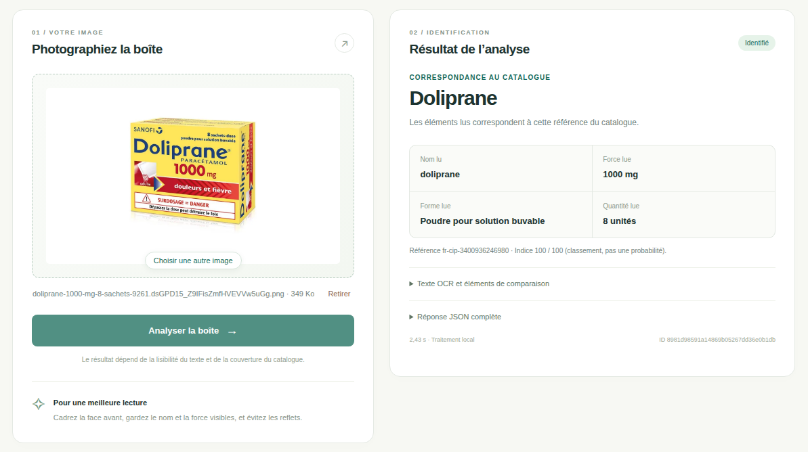
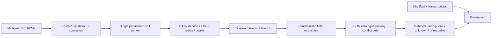
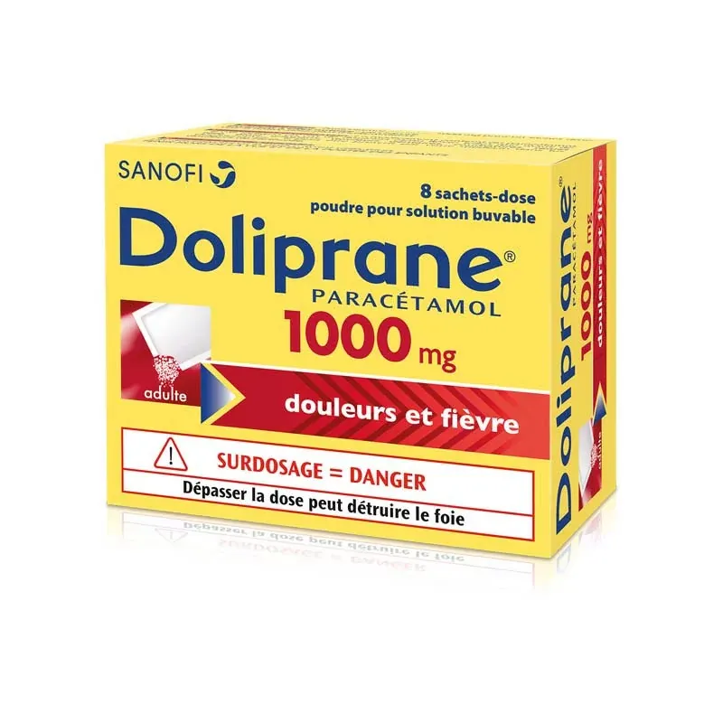

<div align="center">
  <h1>💊 Mediscan — Medication Box Recognition</h1>
  <h3>OCR + Catalogue Matching Microservice | Challenge #2</h3>

  <p>
    A local, CPU-only FastAPI service that reads printed <strong>Arabic &amp; French</strong>
    text from medication boxes and identifies a product <em>only</em> when the visible
    evidence is sufficient. Built with <strong>FastAPI, Tesseract (tesserocr), Pillow and Pydantic</strong>.
  </p>

  
  
  
  
  
  
  
</div>

# **Application Preview**


<br>

## 📝 Table of Contents
1. [Project Overview](#overview)
2. [Architecture & Pipeline](#architecture)
3. [OCR, Extraction & Matching](#matching)
4. [Web Interface & Demo](#demo)
5. [API Contract](#api)
6. [Measured Results](#results)
7. [Reliability & Resource Model](#reliability)
8. [Installation](#install)
9. [Limitations & Roadmap](#limits)
10. [Contact](#contact)

<hr>

<a name="overview"></a>
## 🔭 Project Overview

This project simulates a real-world **medication-box identification** service. It starts from a
photo, reads the printed Arabic/French text with OCR, extracts the identity fields, and matches
them against a local catalogue. The system is deliberately honest: a valid photo does **not**
always produce a product. It distinguishes four outcomes — `matched`, `ambiguous`, `unknown`
and `unreadable`.

**Key Features:**
* **Separation of concerns:** OCR (read) → extraction (fields) → matching (identity). Reading is
  never confused with identification.
* **Catalogue-based ranking:** explicit Arabic/French aliases, canonical strength/form/pack,
  with **conflict veto** (a clear `500 mg` can never match a `1000 mg` reference).
* **Safe abstention:** missing evidence is never filled from the catalogue; the service asks for a
  clearer image instead of guessing.
* **Measured, reproducible evaluation:** 88 synthetic fixtures, held-out split, calibration on
  development only, full JSON reports.
* **CPU-only, local, no external services:** no cloud OCR, no LLM, no training.

> **Delivery status:** working demonstration with a **measured Arabic OCR gap**. The catalogue
> contains 15 fictional variants plus one source-verified French reference (Doliprane 1000 mg,
> powder for oral solution, 8 sachets). The 88 public fixtures are generated images, not real
> medication photographs. French fixtures work well; Arabic-Indic strength digits are unreliable,
> so the service abstains. No production Arabic recognition or Moroccan catalogue coverage is claimed.
> See [measured results](docs/evaluation-results.md) and the [dataset plan](docs/dataset.md).

<a name="architecture"></a>
## 🏗️ Architecture & Pipeline

The project is **monolithic at deployment** (one FastAPI app + one local OCR worker) but cleanly
layered internally, so the logic is testable independently of the OCR engine.



### Layer responsibilities
* **API layer:** HTTP errors, request IDs, byte/pixel limits, admission control, response schema.
* **Worker layer:** decode, EXIF orientation, resizing, OCR, extraction, matching. The OCR engine
  is initialized **once per process**, not once per request.
* **Catalogue layer:** a validated JSON file with provenance, explicit aliases, strength, form and
  pack size. It is loaded and validated once in the worker.

### Catalogue & response contracts
The catalogue stores a stable `product_id`, name, explicit Arabic/French aliases, canonical
strength, form and pack size. Every normal result contains `request_id`, `status`, `raw_ocr_text`,
`extracted_fields`, nullable `matched_product`, `candidates`, `matching_evidence`, `warnings` and
elapsed milliseconds. The API models are the executable schema (Swagger `/docs`, JSON
`/openapi.json`).

<a name="matching"></a>
## 🔬 OCR, Extraction & Matching

### Why Tesseract?
The choice is driven by the environment (Fedora / Python 3.12 / CPU) and simplicity: `tesserocr`
exposes the native Tesseract engine, word boxes and confidence, with small `tessdata_fast` models
and no Torch. EasyOCR and PaddleOCR were studied **documentarily** — no invented benchmark numbers
are claimed, and no comparative accuracy ranking against uninstalled engines is asserted.

### Extraction
The extractor handles common simple `mg`/`g`/`mcg` strengths and `mg/ml` concentrations. It
understands `powder_oral_solution` and sachet pack sizes (the sachet count is **not** a strength).
Percentages, compound strengths, liquid-volume pack sizes and extended-release distinctions abstain
with a warning until the schema and catalogue expand.

### Matching & abstention
* Names are compared against **explicit aliases** with Unicode normalization (French accents,
  Arabic vowel marks/tatweel, Arabic/Persian digits). No transliteration is guessed.
* A name match generates candidates; strength/form/pack then discriminate between them.
* Any explicit **conflict vetoes acceptance**, even with a very close brand name.
* Acceptance requires strong name similarity, a visible matching strength, no conflicts,
  sufficient utility and separation from alternatives.
* The score is a **0–100 ranking utility, never a probability** and never an OCR confidence.

Thresholds were selected on **synthetic development fixtures only** (recorded in
`data/thresholds.json`), with zero observed false accepts as the objective. This is synthetic
development tuning, not clinical or population probability calibration.

> The user-provided yellow Doliprane packshot now returns `matched` (`fr-cip-3400936246980`,
> `1000 mg`, `powder_oral_solution`, `8`). The fix adds sachet extraction, a separately sourced
> reference catalogue, and a bounded layout fallback that independently confirms a large numeric
> region and its adjacent unit — with no hard-coded product coordinates. See
> [the diagnosis and measured regression](docs/doliprane-fix.md).

<a name="demo"></a>
## 🖥️ Web Interface & Demo

Open `/` to drag a JPEG/PNG, preview it, and launch recognition. The responsive French interface is
served locally by FastAPI from `recognition/static/` (no Node/npm, no CDN, no separate frontend
server). It displays status, visible name, strength, form, pack quantity, unconfirmed alternatives,
timing, raw OCR, matching evidence and full JSON. Unknown or ambiguous candidates are never shown
as confirmed products.

<div align="center">
  
  <p><em>User-provided Doliprane packshot used in the real browser test — not a mockup.</em></p>
</div>

### Demonstration scenario
Upload these fixtures in order from `data/demo/images/`:

1. `demo-01-100-fr-test.png`: supported fictional variant → `matched`.
2. `negative-conflict-test.png`: same brand, unsupported 900 mg → `unknown` (conflict veto).
3. `demo-01-250-fr-test-partial.png`: only the brand visible → `ambiguous`.
4. `negative-unknown-test.png`: absent product → `unknown`.
5. `demo-01-100-ar-test.png`: Arabic text preserved; incomplete strength → abstention.
6. `negative-blank-test.png`: valid blank PNG → `unreadable`.

<a name="api"></a>
## 🚀 API Contract

The API runs locally on CPU and communicates only with the local catalogue and OCR engine.

* **Web interface:** `http://127.0.0.1:8000/`
* **Health:** `http://127.0.0.1:8000/health`
* **Swagger:** `http://127.0.0.1:8000/docs`
* **OpenAPI schema:** `http://127.0.0.1:8000/openapi.json`

Single multipart field named `image`:

```bash
curl -sS http://127.0.0.1:8000/health
curl -sS http://127.0.0.1:8000/api/recognize \
  -F 'image=@data/demo/images/demo-01-100-fr-test.png;type=image/png'
```

Representative matched response (word boxes omitted for space):

```json
{
  "request_id": "generated-per-request",
  "status": "matched",
  "raw_ocr_text": "Zefrano\n100 mg\n12 comprimés",
  "extracted_fields": {
    "product_name": "zefrano", "strength": "100 mg", "form": "tablet",
    "pack_size": 12, "observed_strengths": ["100 mg"]
  },
  "matched_product": {
    "product_id": "demo-01-100", "name": "Zefrano", "strength": "100 mg",
    "form": "tablet", "pack_size": 12, "score": 100.0,
    "evidence": ["name_similarity=1.000", "strength: agrees", "form: agrees", "pack_size: agrees"]
  },
  "candidates": [],
  "matching_evidence": ["Visible name and strength supported; no conflicting fields."],
  "warnings": ["Demonstration catalogue: fictional products; real-world coverage is not established."],
  "processing_time_ms": 200.0,
  "ocr_words": []
}
```

HTTP errors use `detail: {request_id, category, message}`. Invalid/corrupt input uses
400/413/415/422; overload 429; dependency failure 503; deadline 504; internal failure 500.
Valid but unrecognizable input returns a structured **200** response. Uploads are not retained,
and logs exclude full OCR text, images and filenames.

<a name="results"></a>
## 📊 Measured Results

> Scope: an **88-image synthetic regression set** (15 fictional variants), zero real packaging
> photos, zero manually transcribed real-photo samples. Reports are in `reports/`. Current
> follow-up metrics are in `reports/evaluation-{dev,test}-layout-fallback.json`.

| Metric | Observed result | Denominator / interpretation |
|---|---:|---|
| End-to-end accepted top-1 accuracy | **42%** | **21/50** known-positive test images |
| Precision among accepted matches | 100% observed | 21/21 accepted; small synthetic sample |
| Acceptance / abstention | 38.89% / 61.11% | 21/54 and 33/54 |
| False accepts on unknown negatives | 0 observed | 0/4; insufficient for a reliable rate |
| Warm latency p50 / p95 | 393 / 1032 ms | 54 requests, decode + OCR + matching |
| Peak evaluation-process RSS | 77.93 MiB | Python + model + Pillow + service |

### Language breakdown
| Language | Images (known / negative) | CER | WER | Accepted correct / known | Top-3 recall |
|---|---:|---:|---:|---:|---:|
| French | 29 (25 / 4) | 4.45% | 5.34% | 21/25 (84%) | 92% |
| Arabic | 25 (25 / 0) | 68.86% | 80.34% | **0/25** | 56% |

**The Arabic result is an important, measured failure — not evidence of supported robust
identification.** Tesseract recovers some Arabic aliases but frequently omits the strength line
and confuses Arabic-Indic digits. Missing fields remain unknown and prevent acceptance. Unit tests
verify Arabic *extraction given correct text*, which does not imply Arabic OCR accuracy.

### Condition breakdown (held-out test)
| Condition | Images | Correct accepted / known |
|---|---:|---:|
| Clear | 30 | 15/30 |
| Blur (synthetic) | 4 | 2/4 |
| Low contrast (synthetic) | 4 | 2/4 |
| 90° rotation (synthetic) | 4 | 2/4 |
| Uneven-light gradient (synthetic) | 4 | 0/4 |
| Name-only partial crop (synthetic) | 4 | 0/4 (expected abstention) |

Contrast stays **disabled by default** (no identification gain in development). Scores are
**0–100 ranking utilities, not probabilities**. CER/WER are micro-averaged edit distances after
NFC normalization and are reported on `primary_ocr_text`, not the merged auxiliary passes.

<a name="reliability"></a>
## 🛡️ Reliability & Resource Model

* One admitted request per API process, including upload reading. Further requests get **429**
  immediately — there is no unbounded queue.
* Limits: 8 MiB image, 16 million decoded pixels, 2000-pixel OCR edge. Upload timeout 10 s;
  worker init and processing each have a 20 s deadline.
* A persistent **spawned** process owns the OCR engine. Native work runs off the event loop.
  On timeout the worker is **terminated and joined**, then lazily reloaded — cancellation of a
  Python thread would not stop native OCR.
* Multiple Uvicorn workers duplicate models, memory and CPU capacity, so use **one** on this CPU
  deployment.
* Health reports degraded on dependency failure and never claims models are available without
  initialization. Images are not retained; client errors contain no traceback.

**Performance note:** static/on-demand dimensions do not apply here; the runtime win comes from
loading models and catalogue once per worker rather than per request, and from bounding retries
(four orientation passes max, at most two extra layout passes and four number/unit crop reads).

<a name="install"></a>
## 💻 How to Run

### Prerequisites
* Fedora (or Linux) with Python 3.12
* No Tesseract CLI required — the Linux `tesserocr` wheel bundles native Tesseract/Leptonica

### Steps

1. **Clone the repository**
   ```bash
   git clone https://github.com/ChahiriAbderrahmane/Challenges_projects.git
   cd Challenges_projects/challenge-2-mediscan
   ```

2. **Create the environment and fetch models**
   ```bash
   sudo dnf install python3.12 python3.12-pip
   python3.12 -m venv .venv312
   source .venv312/bin/activate
   python -m pip install -r requirements.lock
   python -m scripts.fetch_models
   python -m pip check
   ```
   `fetch_models` downloads only official Arabic/French `tessdata_fast` models (~2.6 MB),
   pinned to a Git revision and verified by SHA-256 (see `models/sources.json`).

3. **Start the API**
   ```bash
   export OMP_THREAD_LIMIT=1
   python -m uvicorn recognition.api:app --host 127.0.0.1 --port 8000 --workers 1 --log-level info
   ```

4. **Access the interfaces**
   * **Web UI (French):** `http://127.0.0.1:8000/`
   * **FastAPI Docs:** `http://127.0.0.1:8000/docs`
   * **Health:** `http://127.0.0.1:8000/health`

### Test and reproduce evaluation
```bash
python -m pytest -q
python -m scripts.calibrate
python -m scripts.evaluate --split dev --output reports/evaluation-dev.json
python -m scripts.evaluate --split test --output reports/evaluation-test.json
```
Calibration uses **only** development OCR evidence and must run **before** held-out evaluation.
Current verification: **41 tests passed** locally (one private user-packshot test is skipped when
the asset is absent). Optional browser smoke test with installed Chrome and Node.js 22+:

```bash
node scripts/browser_smoke.mjs
```

Regenerate fixtures (optional):
```bash
sudo dnf install dejavu-sans-mono-fonts google-noto-sans-arabic-vf-fonts
python -m scripts.prepare_demo
```

<a name="limits"></a>
## ⚠️ Limitations & Roadmap

Honest boundaries of this prototype:
* **No real photographs** are part of the 88-image benchmark; public fixtures are generated.
* **Arabic identification is not reliable** (0/25 accepted on the held-out set).
* Only **four negatives** — the false-match rate cannot be estimated reliably.
* Perspective correction and arbitrary deskew are **not validated**; uneven lighting and partial
  views expose real limitations even on synthetic inputs.
* The single real French reference does not prove availability in Morocco or the exact packaging
  artwork; identity facts are not a license on box graphics.

**Next justified step:** collect and transcribe a licensed Arabic/French photo set (target: at
least 15 variants and 60 real photos, with more negatives), then run a controlled CPU comparison
with a scene-text engine and recalibrate on development only. No training, store, pricing or
distributed infrastructure was added.

<a name="contact"></a>
## 📨 Contact Me

[LinkedIn](https://www.linkedin.com/in/abderrahmane-chahiri-151b26237/) •
[Gmail](mailto:chahiri.abderrahmane.eng@gmail.com)

<div align="center">
Made with ❤️ by <a href="https://www.linkedin.com/in/chahiri-abderrahmane/">Abderrahmane Chahiri</a>
</div>
