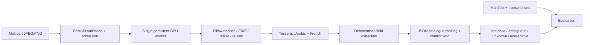

# Medication-box recognition: system design

## Scope and assumptions
Challenge #2 only: visible printed French/Arabic text on boxes, CPU, local
catalogue. No handwriting, clinical interpretation, LLM, training or external
image service. Initial catalogue and rendered fixtures are explicitly synthetic;
real-world identification remains unvalidated until licensed photos are collected.

## Pipeline and separation
API owns HTTP errors, request IDs, byte limits, admission and schema. Worker owns
decode, preprocessing, OCR, extraction and matching. OCR accepts a Pillow image
and returns raw text plus word boxes and engine confidence. Service accepts an
injected OCR adapter for independent tests; API accepts an injected runner.
Catalogue is loaded and validated once in the worker. Engine is initialized once
per worker, not once per request. No web-layer import of chatbot code.

Image validation checks signatures and actual decoder format, verifies and fully
loads JPEG/PNG, rejects animation, truncated data, excessive bytes/pixels and
tiny images. EXIF orientation is applied before aspect-preserving reduction.
Original decoded baseline is retained in memory only. Quality warnings are
advisory, not unsupported claims of reliable blur diagnosis. Contrast is opt-in
and must be evaluated against baseline. No automatic binarization/deskewing.
Orthogonal rotation retries are bounded and only used when initial OCR lacks
sufficient identifiable evidence; choose OCR evidence, never merge contradictory
strengths into an accepted match. The Doliprane follow-up adds a bounded baseline
layout fallback: block + sparse OCR and at most two independently confirmed
number/adjacent-unit pairs. Raw passes are labelled and retained, conflicting
strengths veto acceptance, and primary OCR is exposed separately for CER/WER.
Arbitrary perspective/skew correction is deferred pending photographs.

## Catalogue and response contracts
JSON catalogue: provenance, rights, synthetic flag, products with stable ID,
name, explicit Arabic/French aliases, canonical strength, form and pack size.
The regenerable demo catalogue can name separately authored local supplements;
one French BDPM-sourced Doliprane record is now included. Warnings distinguish
fictional records from limited sourced coverage.
No ingredient is asserted for invented products. Pack quantity is separate from
strength; compounds/unsupported strengths stay unknown with a warning.
API models are the executable schema (Swagger `/docs`, JSON `/openapi.json`).
Every normal result contains request_id, status, raw_ocr_text, extracted_fields,
nullable matched_product, candidates, matching_evidence, warnings and elapsed
milliseconds. Candidates expose product_id/name/strength/form/pack_size/score
and evidence. Score is a ranking utility on 0–100, never a probability or OCR
confidence. OCR word confidences describe characters only.

## Matching and abstention
Unicode normalization handles French accents, Arabic vowel marks/tatweel and
Arabic/Persian digits, preserving Arabic letter distinctions and decimal values.
Names are compared against explicit aliases using contiguous token windows.
No transliteration is guessed. Strength units are canonicalized, including g to
mg and concentration denominators. Name evidence is required; numbers alone do
not identify a product. Explicit strength/form/pack conflicts veto acceptance.
Missing evidence is not filled from the catalogue. Acceptance requires strong
name similarity, a visible matching strength, no conflicts, sufficient utility
and separation from plausible alternatives. Otherwise return alternatives with
an explanation; illegible text returns unreadable and requests a clearer image.
Multiple conflicting strengths remain unresolved and cannot be accepted.
Threshold grid is selected on development fixtures only, recorded in a config
artifact; held-out families do not influence it. This is synthetic development
tuning, not clinical or population probability calibration.

## OCR decision and related work
Official sources checked 2026-10-27:

* [Tesseract language data](https://tesseract-ocr.github.io/tessdoc/Data-Files-in-different-versions.html)
  confirms `ara`, `fra`, `tessdata_fast` LSTM models. [tesserocr](https://github.com/sirfz/tesserocr)
  exposes reusable PyTessBaseAPI, word boxes and confidence; Python wheel avoids
  needing a missing CLI. Small language models, native CPU execution, no Torch.
* [EasyOCR languages](https://www.jaided.ai/easyocr/) lists Arabic `ar` and French
  `fr`. Its script-combination restrictions mean that listing both languages is
  not proof they can share one recognizer. Torch plus detector/recognizer models
  increase installation and memory burden. Scene-text detection is attractive for
  perspective packaging; not installed without measured need.
* [PaddleOCR multilingual models](https://www.paddleocr.ai/main/en/version3.x/algorithm/PP-OCRv5/PP-OCRv5_multi_languages.html)
  lists distinct Arabic and Latin recognizers and CPU-capable pipelines. Separate
  models/runtime and pipeline configuration add complexity. Published benchmark
  accuracy is not evidence of performance on our boxes.

Initial choice: Tesseract fast Arabic+French. Benchmark it on available rendered
French/Arabic samples, record errors, latency and worker RSS. No comparative
accuracy ranking against uninstalled engines is claimed. A multi-engine trial
on consented real photos is a next step if scene-text failures justify downloads.

## Resource and failure model
One admitted recognition request per API process; reject overload immediately
with 429 and Retry-After. Multipart body is bounded before parsing (8 MiB image,
small envelope allowance); upload read timeout is separate from CPU deadline.
Maximum decoded pixels 16 million, OCR longest edge 2000. Native worker lives in
a spawned process, requests run off the event loop. A CPU deadline terminates
and joins that process before releasing admission; next request can reload it.
This deliberately avoids pretending cancellation of a Python thread stops native
OCR. Process death returns a sanitized failure. Health reports degraded on
dependency failure and never reports models available without initialization.
One server worker recommended: each additional worker duplicates OCR models,
catalogue and admission capacity, increasing CPU/memory and changing overload
behavior. No queue or automatic retry. A hung upload occupies admission only
until its read deadline. Temporary multipart spooling may occur locally during
parsing and is closed promptly; image content is never retained intentionally.

HTTP: 400 malformed multipart/corrupt image, 413 size/pixel limit, 415 unsupported
format, 422 missing image, 429 overload, 503 unavailable OCR, 504 upload/CPU
deadline, 500 unexpected failure. Valid unknown/unreadable images return 200.
Logs contain generated request IDs, durations and categories, not OCR text,
filenames, images, or client-visible tracebacks.
